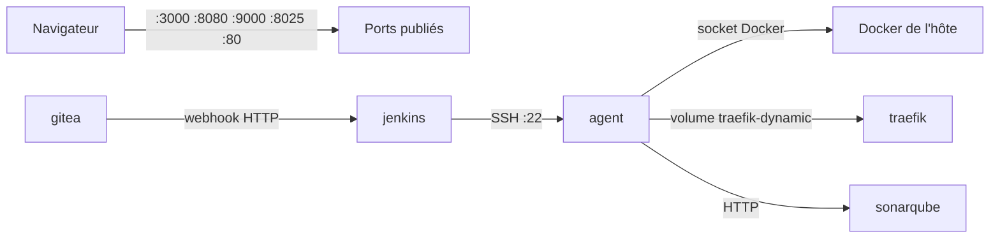

# Module 00 — Corrections

## Lab 00.1 ⭐ — Démarrer et vérifier la pile
### Solution
Étapes de l'énoncé exécutées telles quelles. Points de contrôle :
- `environnement/.env` créé (mots de passe aléatoires, clé publique de l'agent) ; `environnement/secrets/agent_ed25519` = clé privée de l'agent, utilisée au module 02.
- `environnement/jenkins/casc/` = configuration JCasC de travail (copie de `casc-initial/`), modifiée par les labs et les rattrapages ; hors Git.
- SonarQube : premier démarrage 2 à 3 min après Jenkins (index Elasticsearch embarqué).

### Pourquoi
- Une pile identique pour tous (versions figées) = des sorties attendues reproductibles.
- Mots de passe générés par poste : aucun secret partagé ni versionné.

### Erreurs fréquentes
| Symptôme | Cause | Déblocage |
|---|---|---|
| `Ports are not available: ... :80` | Port 80 occupé (serveur web local) | `TRAEFIK_PORT=8000 scripts/setup/init-env.sh` ; URL des applications en `:8000` |
| SonarQube redémarre en boucle | `vm.max_map_count` trop bas ou mémoire insuffisante | `sudo sysctl -w vm.max_map_count=524288` ; sinon profil `leger` |
| Docker Desktop s'arrête pendant le démarrage | Mémoire allouée insuffisante (autres conteneurs actifs) | Arrêter les autres conteneurs ; Docker Desktop ≥ 8 Go ; profil `leger` |
| `required variable JENKINS_AGENT_SSH_PUBKEY is missing` | `docker compose` lancé sans `init-env.sh` | Lancer `scripts/setup/init-env.sh` (crée `.env`) |
| Page Gitea inaccessible en cloud | Tunnel SSH fermé | Relancer la commande `ssh -N -L ...` |

## Exercice 00.2 ⭐⭐ — Quiz de positionnement
### Grille
1. `git switch -c <branche>` (ou `git checkout -b <branche>`).
2. `merge` crée un commit de fusion et conserve l'historique ; `rebase` rejoue les commits sur une autre base (historique linéaire, commits réécrits).
3. `docker ps`.
4. Déclarer les dépendances (et, pour `pyproject.toml`, les métadonnées et la configuration des outils).
5. Le comportement d'une petite unité de code (fonction, classe), isolée de ses dépendances.
6. Continuous Integration : intégration fréquente du code dans une branche commune, vérifiée automatiquement.
7. Demande de fusion d'une branche, support de la revue de code et des vérifications automatiques.
8. `cat <fichier>` (ou `less <fichier>`).
9. Valeur nommée transmise par l'environnement d'exécution à un processus (ex. `PATH`).
10. Format texte de données structurées par indentation (clés / valeurs, listes), utilisé par Compose, JCasC, Kubernetes.

### Lecture du score
| Score | Lecture | Action |
|---|---|---|
| 8 à 10 | Prérequis acquis | Viser les défis ⭐⭐⭐ |
| 5 à 7 | Bases présentes | Labs ⭐ et ⭐⭐ ; binôme avec un profil plus avancé |
| 0 à 4 | Prérequis fragiles | Labs ⭐ ; kit de prérequis (`scripts/setup/prerequis-kit.md`) le soir du J1 |

## Défi 00.3 ⭐⭐⭐ — Cartographier les flux
### Solution

- Réseau unique `cicd` : résolution par nom de service (`gitea`, `jenkins`, `sonarqube`, `traefik`, `mailpit`).
- Volume `traefik-dynamic` partagé entre l'agent (écriture de `prod.yml`) et Traefik (lecture).
- Socket Docker monté dans l'agent : déploiements possibles, mais accès équivalent à root sur l'hôte (étudié au module 09).

## Bonus
Le compte `admin` est défini dans `securityRealm.local.users` ; le mot de passe vaut `${JENKINS_ADMIN_PASSWORD}` : JCasC remplace la variable par la valeur de l'environnement du conteneur (fichier `.env`), le fichier versionné ne contient donc aucun secret.

## QCM — Réponses
1. **B** — Le webhook Gitea cible `http://jenkins:8080/gitea-webhook/post`.
2. **C** — Le contrôleur n'a aucun exécuteur (à partir du module 02) ; les étapes tournent sur l'agent.
3. **B** — État final : livraison continue jusqu'à la production, seule la recette demande une approbation.
4. **C** — L'aide est attendue ; le rattrapage garantit un départ commun au module suivant.
5. **B** — Le profil `leger` retire SonarQube (≈ 2,5 Go de mémoire).
